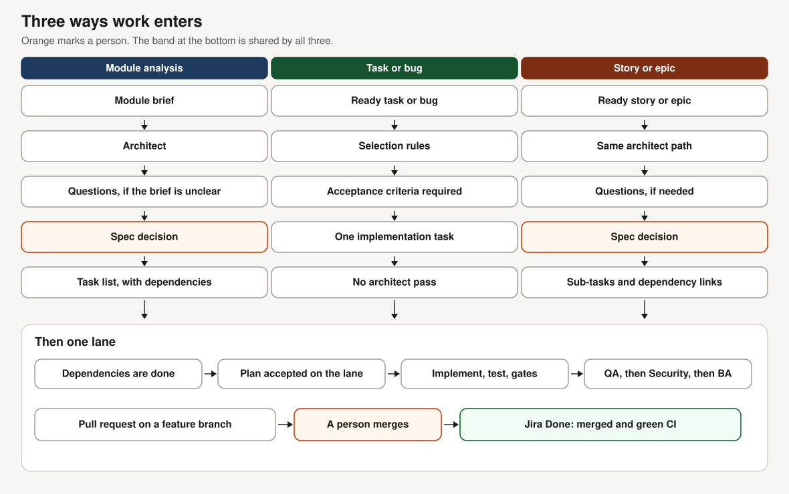

# Fleet — AI SDLC Orchestrator

Fleet is a multi-agent AI orchestrator for software delivery. It coordinates planning, implementation, testing, review, and pull requests. Work starts from a module analysis, or from a Jira task, bug, story, or epic that passes the selection rules.

The agents share a scheduler and a durable record of the work. They do not share one conversation. Spec decisions follow configurable human-approval and timeout policies. Merge remains manual by default.

## Problem

A feature arrives as a long analysis or as a tracker issue. Someone has to split it into tasks, keep the dependency order, and review the result apart from the person or agent that wrote the code. An agent that takes every open issue will also take the wrong ones: an issue a teammate already owns, or a bug with no acceptance criteria.

## From input to pull request

A module brief is analysed into a spec and a task list. A ready task or bug becomes one implementation task and skips the architect. A ready story or epic uses the same architect path, then becomes sub-tasks whose links record the dependencies.

On the operating path, a lane produces a plan and accepts it, implements in a worktree, and runs tests and the quality gates that are switched on. QA reviews the diff and the test results. Security reviews the same kind of evidence only when the task is marked sensitive or its text matches auth, login, token, password, or payment. A business-analyst pass triages the findings. A pull request opens on a feature branch after a clean review. Opening that pull request and merging it are different steps. Merge stays with a person unless that automation is turned on.

The lane does not sit idle while a person answers. The question is saved, other ready work continues, and the answered item resumes on the next free compatible lane before new work starts.

## Capabilities

- Module analysis becomes a spec, clarification questions when the brief is unclear, and tasks with dependencies.
- A ready Jira task or bug, with acceptance criteria and one clear lane, runs as a single implementation task.
- A ready story or epic is analysed, then mirrored as sub-tasks. A task waits until the tasks it depends on are done.
- Human answers arrive through Slack, the docs hub, or a Jira comment. The first valid answer wins.
- QA and Security prompts are built from the diff, the test results, and, for QA, the spec title. They do not include the developer transcript or the full spec. This is a separation of prompt inputs, not a separate machine.
- Lane state, continuations, leases, and an outbox are written so a crash can resume. Corrupt interaction files are quarantined rather than replaced with an empty store.
- Quality gates and the human decisions below are configuration. Several gates can be turned off. Several approvals can be left to a timeout policy.

Jira writes are off until enabled. With the default, Fleet reports what it would claim and does not take the issue.

## Contribution

Fleet was developed by Yunus Emre Cebe. The delivery orchestrator that became Fleet has 535 commits on `main`, counted at revision `5312a9ae` on 23 October 2026. That count is the orchestrator's development history, including the work done before Fleet had its own repository. It is not the commit count of the published Fleet engine repository. The work ran from 1 September 2026 through the extraction on 21 October 2026, and the engine was separated on 22 October 2026.

In the earlier system the scheduler, the architect, the lane workers, dependency ordering, worktree implementation, quality gates, and the separated review prompts were already in use. Fleet is that system abstracted into its own engine repository and made product-neutral, with a crash-safe state layer, Jira as a second input, and human handoffs that release the lane instead of blocking it.

Dates, path scope, and the engine revision these pages were checked against are in [Provenance](docs/provenance.md).

## Technology

| Piece | Role |
|---|---|
| Python 3.11+ | Engine implementation |
| LangGraph | The developer subgraph used while a lane implements one task, and a separate per-feature SDLC graph |
| Planner and lane workers | The operating scheduler. It is not the per-feature graph |
| Jira, Slack, docs hub | Intake and human channels |
| Git worktrees | Feature-branch implementation and pull requests |

The per-feature graph runs architect, spec approval, development, QA, Security, triage, and merge review as one checkpointed flow. Day-to-day operation is the planner plus lanes. Those two paths do not use the same approval defaults. [Architecture](docs/architecture.md) separates them.

## Walkthrough

[Illustrative walkthrough](docs/case-study.md). It follows acceptance tests that drive the planner and the tracker against a fake Jira. The model and git hosting are stubbed. It is not a live product delivery and not a measure of model quality.

## Status and limits

The published engine is alpha and is not a public package. These pages were checked against engine revision `0e1693d` (22 October 2026).

Spec approval asks a person, then approves on timeout unless that switch is off. The daytime wait is 3 hours. From 00:00 to 09:00 Europe/Istanbul it is 180 seconds. The lane path accepts the implementation plan without a separate plan review. A pull request opens after review unless that automation is off. A pull-request approval gate exists and defaults to off. Merge automation defaults to off.

Under the default Jira settings, Done requires a merged pull request and green CI. `done_on` and `ci_required` can change that. A repository with no checks does not reach Done while CI is required.

Security review does not run for every task. An empty Jira reporter allow-list takes nothing. Details and the other filters are in [Status](docs/status.md) and [Workflows](docs/workflows.md).

No speed, cost, success rate, or production volume is stated. None was measured for this repository.

## Read next

| Read | For |
|---|---|
| [Workflows](docs/workflows.md) | The three intakes side by side |
| [Architecture](docs/architecture.md) | Scheduler, graphs, state, and approval defaults |
| [Walkthrough](docs/case-study.md) | The illustrative sequence |
| [Status](docs/status.md) | What is in the published engine, and the limits |
| [Provenance](docs/provenance.md) | Dates, authorship, and the revision that was checked |
| [Slides](presentation/slides.md) | Seven slides ([PDF](presentation/fleet-showcase.pdf)) |
| [LinkedIn drafts](linkedin-project.md) | Project and Featured text |
