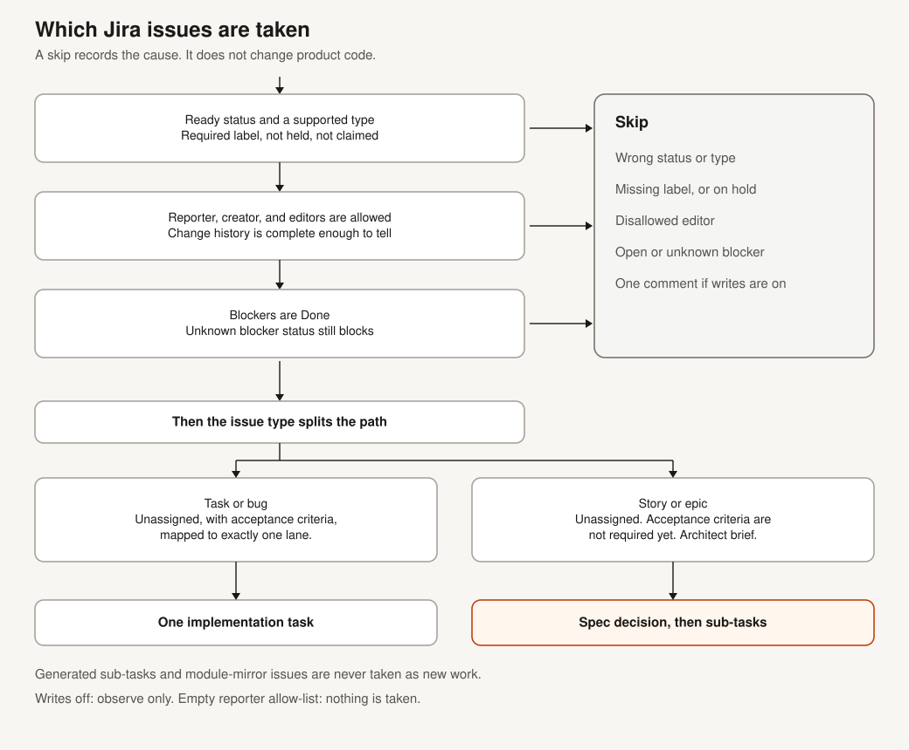
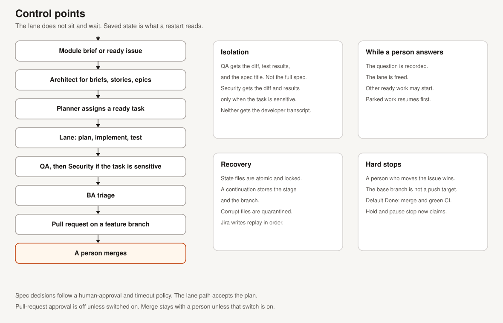

# Diagrams

These SVGs are the pictures for the description. GitHub renders them from the links below. The editable source is [`src/render_diagrams.py`](src/render_diagrams.py). Run that file to regenerate the SVGs in this folder and in `src/`.

Orange marks a decision a person makes. The other boxes are engine steps.

The same pictures are discussed in [Workflows](../docs/workflows.md) and [Architecture](../docs/architecture.md).
