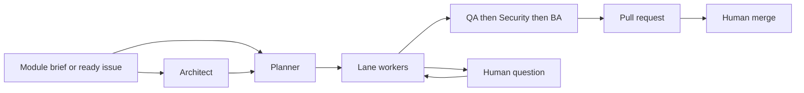

# Architecture and control points

Fleet is a workspace-driven engine. Product repositories hold application code. The workspace holds configuration, role cards, analysis briefs, and runtime state. The engine package holds the scheduler. A local, uncommitted change also lets one platform point at its own git checkout; until that lands, every platform uses the single product checkout.

The operating loop is `run-fleet`: a planner, an architect loop, one worker per lane, and a communications thread. A second path, the per-feature LangGraph, still exists for a single-feature run and stores a SQLite checkpoint. The two paths do not apply the same approval defaults. This page describes the lane path unless it says otherwise.

## Components

| Piece | Role |
|---|---|
| Architect | Reads a module brief or a story/epic brief. Asks clarification questions. Writes the spec and the task list. |
| Planner | Polls inputs, assigns a ready task to a free lane, and prefers parked work that already has an answer. |
| Lane worker | Plans, implements in a worktree, runs tests and gates, then review. Opens a pull request when that step is enabled. |
| QA, Security, BA | Separate reviews after implementation. BA triages findings. |
| Interaction layer | Records a question or approval, publishes it, and resumes the owner when an answer arrives. |
| Jira tracker | Claims, comments, and status moves. Dry-run until writes are enabled. |
| State layer | Atomic, locked JSON for lane state, continuations, and Jira sync. Quarantine on corruption. |

Role text lives in role cards loaded into prompts. The graph nodes do not hardcode those role essays.

## Context isolation

QA and Security are separate prompt builds.

QA receives the task results, the spec title, prior review memory, and a git diff of the worktree. The prompt tells QA to judge from those outputs. The QA function does not load the developer plan or the implementer transcript.

Security receives the task results and the same kind of diff. Its prompt tells it to ignore QA findings, and the QA finding list is not inserted into that prompt. Security does not load the developer plan either.

This is isolation by what the prompt contains. The two reviews are separate functions, and the developer plan is not an argument to either one. It is not a second machine or a cryptographic seal. Both reviews can still see test output, which includes whatever the test run printed.

BA runs after both and does see their findings. That is the triage step.

## State, checkpoints, and recovery

Lane state, the interaction registry, continuations, and Jira sync store references and short records. Specs and plans live as artifact files. Persistent JSON and JSONL writes go through an atomic helper: write a sibling temp file, flush, then replace. A crash leaves the previous file intact. Two processes take an advisory lock before a read-modify-write. A corrupt registry or continuation file is quarantined. Readers see an empty view, writers refuse, and an operator recovers from the quarantine copy. The file is not silently replaced with an empty store.

The LangGraph path checkpoints to SQLite so a single-feature run can resume after a process restart. The lane path does not depend on that database for parked work. A continuation stores the stage, branch, commit, and artifact refs. Heavy model context is rebuilt from those artifacts when the work resumes.

On startup the lane runner reconciles lanes and continuations, polls channels once, and resumes anything answered while it was down. Jira writes sit in an outbox and flush in order after an outage. A claim is a lease. If the process dies, the lease expires and another host can pick the issue up. One engine process per workspace is enforced with a lock.

## Quality gates

Gates run on the implement and verify path. They include a merge-suite comparison against a baseline, schema drift, stub or fixture checks, a web TypeScript check on touched files, a shared-file guard, an assertion-flip guard, and regression checks for routes and similar catalogs. A repeated guard failure is remembered and escalated to a person after a configured repeat count.

Each gate has an environment switch that turns it off. A product that disables a gate is running without that check. Baselines for known debt live in the workspace.

Review itself is bounded. QA and Security run, then BA. Automatic fix rounds default to 3 (`SDLC_FLEET_AUTO_FIX_ROUNDS`). High-priority tasks and shell or layout tasks use at most one. A code comment nearby still says the default is 2; the constant is 3. The cap stops the loop. It is not raised quietly. On the graph path, spec rejection stops after 3 rejects and plan rejection stops after 2.

## Human decisions and automatic limits

These are the defaults in code, including timeout behaviour.

| Decision | Lane-path default |
|---|---|
| Module clarification questions | Stay open. No timeout answer. Other modules can proceed, up to 3 parked specs. |
| Spec approval | A person is asked. If nobody answers, the default timeout approves the spec. Daytime wait is 3 hours. From 00:00 to 09:00 Europe/Istanbul the wait is 180 seconds. Set the timeout switch off to keep waiting. |
| Task questions | The task is parked. On timeout it is deferred, not answered by assumption. |
| Implementation plan | On the lane path the plan is generated and then accepted. A human plan review exists on the single-task command when auto-approve is left off. |
| Pull request | Opens after a clean review. A human approval gate exists and defaults to off. If enabled, overnight can approve on timeout and daytime defers the task. |
| Merge | A person merges. Jira `auto_merge` defaults to off. |
| Jira Done | Requires a merged pull request and green CI. A repository that reports no checks does not reach Done while CI is required. |
| Finding triage timeout | Defaults to approve-the-fix. |

Unrecognised replies to an approval are ignored on the lane path. They are not counted as a rejection. The first valid answer across channels wins. A later conflicting answer is recorded and the sender is told the decision already happened.

Jira adds a hard stop: if a person moves the issue out of progress, unassigns it, cancels it, or edits the text after the claim, Fleet stops at the next safe point, before push, leaves one comment, and releases the lease. It does not force the status back.

## Orchestration choices

The planner's order is deliberate. Answered parked work comes before new work. A task whose `depends_on_tasks` are unfinished stays queued. A non-backend task can also wait on named backend tasks. New Jira claims are capped by the lane count, and a pause file or a hold label stops new claims immediately. Running work continues until the next safe point.

Story and epic sub-tasks that Fleet creates are labeled as generated. The poller never takes them as fresh input. A tracking epic created to mirror a module is excluded the same way.

The child-process environment for agents, builds, tests, and git is an allowlist. Names that look like tokens are dropped unless the workspace lists that exact name. Issue text is treated as data: it is quoted, length-capped, and cannot set the write scope. Write scope comes from the lane and the plan.

## Where the engine docs disagree

The engine policy says human checkpoints are never auto-bypassed, and the engine architecture page lists spec, plan, and merge review as never automated. The code above is narrower. Spec approval auto-approves on timeout by default. The lane path accepts the plan. Pull-request approval is opt-in. The engine architecture page also describes the LangGraph picture and omits Jira and the non-blocking lane scheduler. The operations notes describe the lane scheduler. Both paths are in the tree. Trust the code for the defaults on this page.
