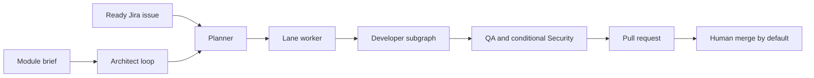

# Architecture

Fleet coordinates several model-backed roles. The operating scheduler and the per-feature graph are different pieces of code. This page describes the published engine at `0e1693d`.

## Where things live

Product repositories hold application code. A workspace beside the engine holds configuration, role cards, analysis briefs, and runtime state. The engine package holds the scheduler. Configuration is a YAML profile. Unknown keys are rejected. Role essays are loaded from role cards into prompts. The nodes do not hardcode those essays.

One product checkout is the published default. A local, unpublished edit can point a platform at its own checkout. That edit is not part of `0e1693d`. See [Provenance](provenance.md).

## Two execution paths

| Path | What runs it | What it is for |
|---|---|---|
| Lane scheduler | Planner, architect loop, one worker per lane, communications thread | Continuous operation across modules and Jira issues |
| Per-feature graph | One LangGraph over architect, spec approval, developer, QA, Security, triage, and merge review | A single feature run, with a SQLite checkpoint |

A lane does use LangGraph for the developer subgraph of one task: plan, then implement. That subgraph is not the per-feature graph, and the planner is not LangGraph. Approval defaults differ. The lane path accepts the plan. The per-feature graph can stop at a plan interrupt when auto-approve is off.

## Roles

| Role | Job |
|---|---|
| Architect | Reads a module brief or a story or epic brief. Asks when the brief is unclear. Writes the spec and the tasks. |
| Developer | Plans and implements one task on a lane, inside a worktree. |
| QA | Reviews after implementation, from the inputs below. |
| Security | Reviews only when the task is in scope for security. |
| BA | Triages QA and Security findings. |

A task or bug from Jira does not go through the architect. The poll turns it into one task.

## What review actually receives

QA's prompt is assembled from the task results, the spec title, prior review memory, the QA role card, and a git diff of the worktree. The full spec body is not inserted. The developer plan and the implementer transcript are not loaded.

Security runs when a task is marked security-sensitive, or when the task record contains auth, login, token, password, or payment. Otherwise the function returns no findings. When it runs, the prompt gets the task results, the security role card, review memory, and the diff. QA findings are not inserted. The developer transcript is not loaded. The spec is read only to decide whether this review should run.

BA then sees the findings. That is the triage step.

This separation is which strings are placed in which prompt. It is not a second process, host, or permission boundary. Test output can still contain whatever the test run printed.

## Scheduling and dependencies

The planner prefers parked work that already has an answer over new work. A task whose dependencies are unfinished stays queued. A non-backend task can also wait on named backend tasks. New Jira claims are capped by the lane count. A pause file or a hold label stops new claims. Running work continues until the next safe point, before push.

Story and epic sub-tasks that Fleet creates are labeled as generated. The poller does not take them as new input. A tracking issue created to mirror a module is excluded the same way.

## State and recovery

Lane state, the interaction registry, continuations, and Jira sync store short records and references. Specs and plans are artifact files. JSON writes go through an atomic replace under an advisory lock. A crash leaves the previous file. A corrupt registry or continuation file is quarantined. Writers refuse until an operator recovers it. It is not replaced with an empty document.

The per-feature graph checkpoints to SQLite. The lane path resumes from continuations: stage, branch, commit, and artifact refs. Model context is rebuilt from those artifacts.

On startup the lane runner reconciles lanes, polls channels once, and resumes anything answered while it was down. Jira writes sit in an outbox and flush in order. A claim is a lease. If the process dies, the lease expires. One engine process per workspace holds a lock.

Issue text is data. It is quoted and length-capped, and it does not set the write scope. The scope comes from the lane and the plan. Child processes for the agent, builds, tests, and git receive an allowlisted environment. Names that look like tokens are dropped unless the workspace lists that exact name.

## Human decisions and quality gates

Defaults on the lane path:

| Decision | Default |
|---|---|
| Module questions | Stay open. No invented answer. Other modules can proceed, up to 3 parked specs. |
| Spec approval | A person is asked. Timeout approves unless the switch is off. Daytime wait is 3 hours. From 00:00 to 09:00 Europe/Istanbul the wait is 180 seconds. |
| Task questions | The task is parked. Timeout defers it. |
| Implementation plan | Generated and accepted. A human plan review exists on the single-task command when auto-approve is left off, and on the per-feature graph. |
| Pull request | Opens after a clean review. An approval gate exists and defaults to off. |
| Merge | A person merges. Jira `auto_merge` defaults to off. |
| Jira Done | Default `done_on` is merged, and `ci_required` is on, so Done waits for a merged pull request and green CI. Either setting can be changed. No checks means not Done while CI is required. |
| Finding triage timeout | Approves the fix. |

Unrecognised approval replies are ignored. They are not counted as a rejection. Automatic fix rounds default to 3. High-priority and shell tasks use at most one. The cap stops the loop.

Quality gates on the implement path include merge-suite comparison, schema drift, stub checks, a web TypeScript check, a shared-file guard, an assertion-flip guard, and regression checks. Each gate has an environment switch. A repeated guard failure is remembered and escalated after a configured repeat count.

If a person moves a claimed Jira issue, unassigns it, or edits the text, Fleet stops before push, comments once, and releases the lease. It does not force the status back.
